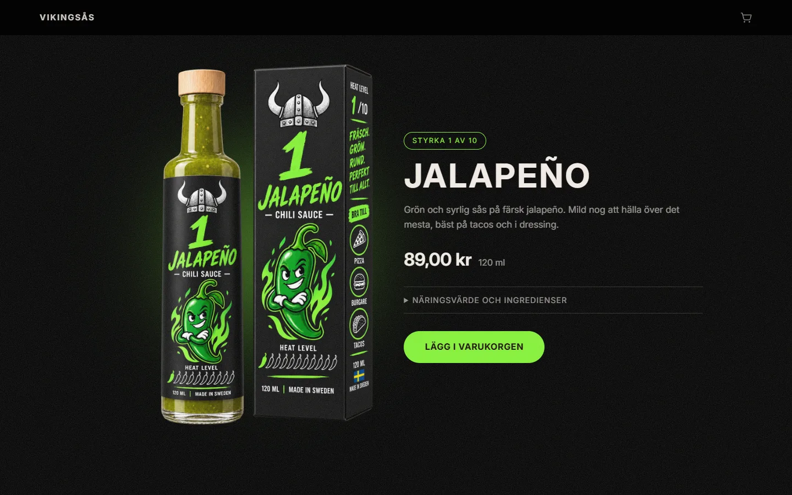
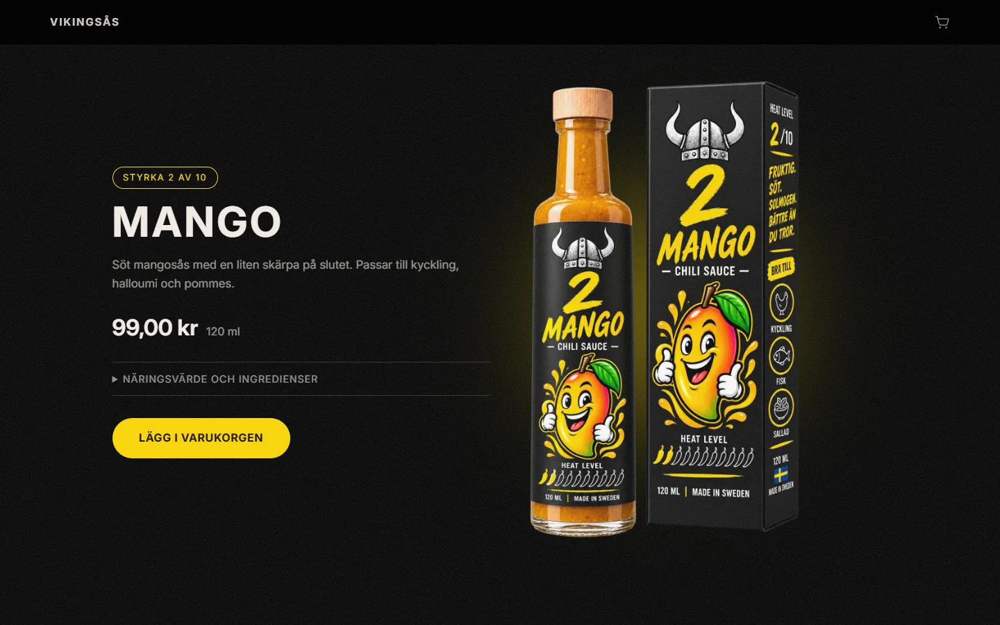
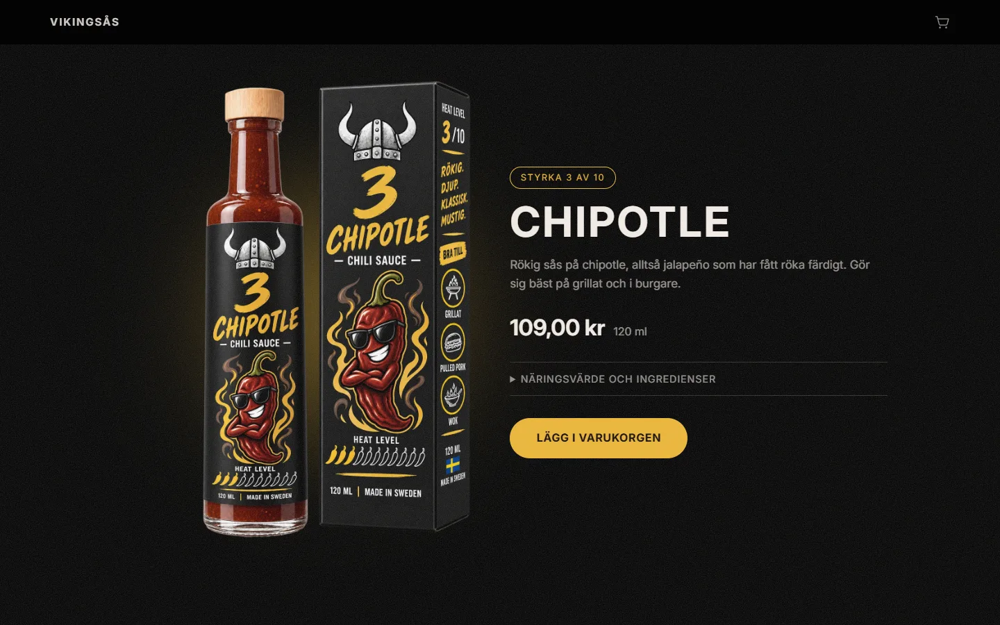
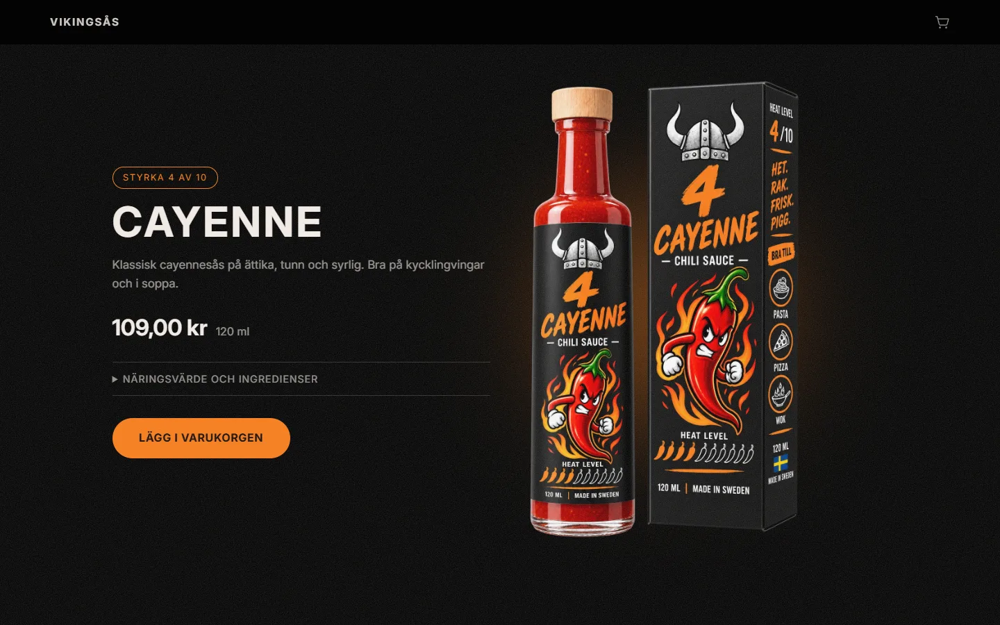
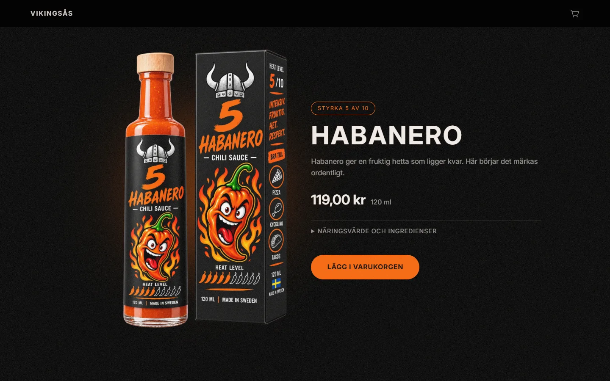
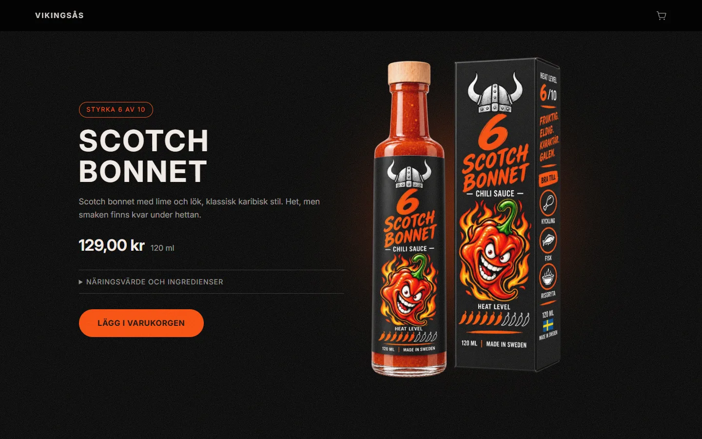
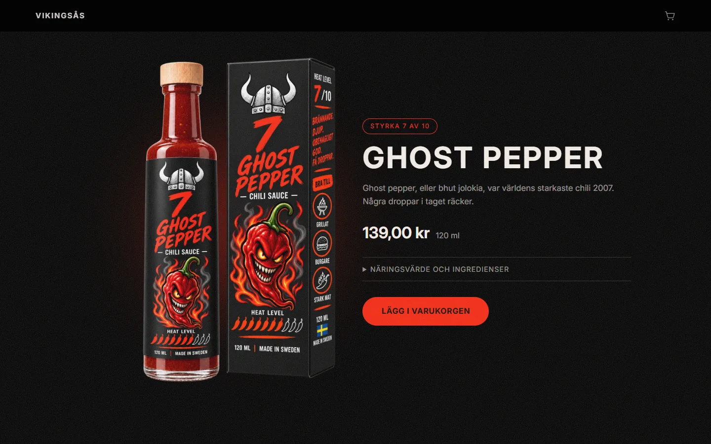
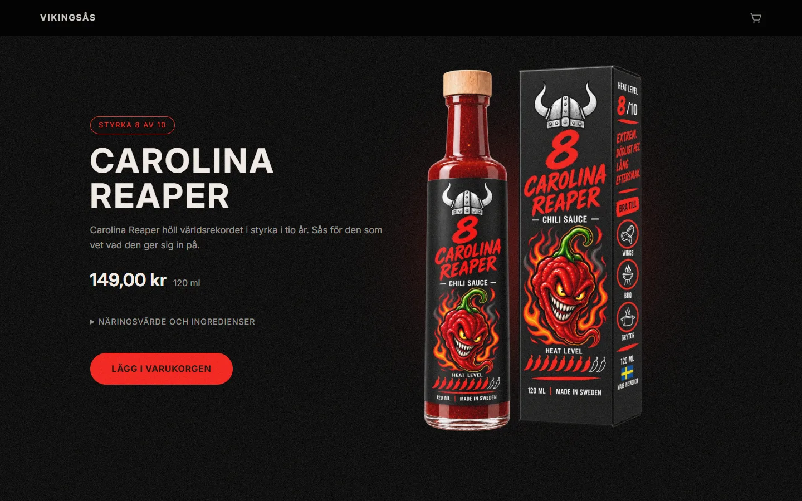
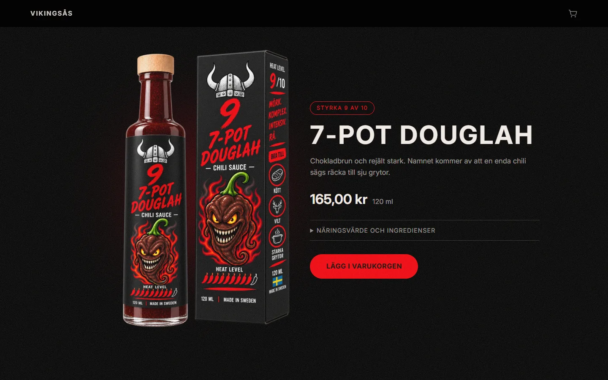
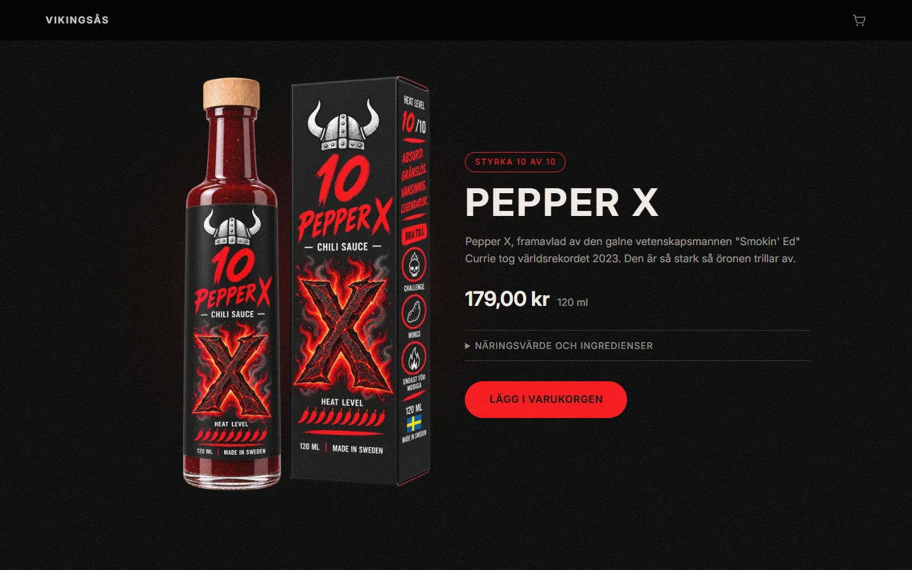

# Vikingsås

E-handel med tio chilisåser i stigande styrka, från en mild jalapeño till Pepper X. Byggd som skoluppgift i kursen Systemutveckling på Medieinstitutet.

Vidareutvecklad i kursen Integration med 3-partssystem.

Sajten ligger på https://chili-ehandel.vercel.app


## Om uppgiften

Uppgiften hette "Min egna e-handel" och gick ut på att bygga en butik som fungerar för både kunder och administratörer. Admin lägger till och redigerar produkter som sparas i databasen. Kunden ser produkterna, lägger dem i en varukorg, "betalar" och skapar en order som admin sedan kan se. Betalningen är bara ett formulär med namn och e-post, ingen riktig betallösning. Sidan skulle också vara deployad så att andra kan se den.

Innan bygget skulle tidsplan, sitemap och ER-diagram tas fram. De ligger i [docs/](docs/).

För VG skulle dessutom:

- varukorgen sparas i databasen istället för bara i React
- det finnas inloggning så att bara administratörer kan redigera produkter
- admin kunna sätta orderstatus: Beställd, Behandlas, Levererad, Återbetald

Alla krav för både G och VG är uppfyllda.

## Produkterna

Varje sås har en egen sektion på startsidan med styrka, pris och en utfällbar ruta för näringsvärde och ingredienser. Glöden bakom flaskan och knappen har samma färg som etiketten.

<p>
  
  
  
  
  
  
  
  
  
  
</p>

## Funktioner

### Kund

- mina tio egna såser på startsidan
- alla produkter med sökning och bläddring på `/produkter`
- priser i SEK, EUR, NOK eller DKK
- varukorg som sparas i databasen och kopplas till besökaren med en cookie, kunder behöver inte logga in
- kassa med namn, e-post, telefon och adress, och kortbetalning med Stripe
- tacksida som visar ordern och om betalningen har gått igenom

### Admin

- inloggning med express-session, sessionerna sparas i Postgres och lösenorden hashas med bcrypt
- skapa och redigera produkter, och slå av eller på dem med en switch
- importera leverantörens produkter som CSV eller XML
- lista med alla ordrar och en detaljsida per order, med betalstatus
- ändra orderstatus

Adminpanelen länkas inte från butiken, den nås på `/admin/logga-in`.

## Tekniker

- React, Vite och React Router
- Express 5 och TypeScript
- PostgreSQL hos Supabase, egen SQL via `pg`
- express-session med connect-pg-simple, bcryptjs
- Zod för att validera data från andra system och från webbläsaren
- Algolia för sökningen, Stripe för betalningen, Frankfurter för valutakurserna
- Vercel

## Vad jag övade på

- rita ett ER-diagram och bygga tabellerna efter det
- spara produktnamn och pris på orderraden, så att en gammal order inte ändras när admin ändrar priset
- transaktioner, en order och dess rader sparas allt eller inget
- `json_agg` för att hämta en order med alla rader i en och samma fråga
- sessionsbaserad inloggning och middleware som skyddar admin-routes
- React Context för antalet i varukorgen
- deploy med Vercel CLI

## Integrationer

I kursen Integration med 3e partssystem byggde jag vidare på samma butik och kopplade ihop den med externa tjänster. Alla anrop går via Express, varje tjänst har en egen adapter i `server/integrations/` och nycklarna ligger i `.env`.

### Import från leverantören

Admin kan hämta leverantörens produktkatalog som CSV eller XML, med en knapp per format på produktsidan i admin. Varje rad valideras med Zod innan den sparas, och efteråt visas en rapport med nya, uppdaterade och överhoppade produkter. Importen gör upsert på artikelnumret, så en andra import skapar inga dubbletter.

Så här gjorde jag med fälten:

- **Artikelnummer** sparas i en ny kolumn i databasen, `sku` som är unik. Det är den importen använder för att avgöra om produkten redan finns, och den blir `objectID` i Algolia. Mina egna tio såser fick VS-001 till VS-010.
- **EAN** sparas som text, inte tal annars försvinner nollan i början.
- **Kategori** sparas i `category` i products så att den kan användas som filter i sökningen. Den borde nog läggas som egen tabell så att samma kategori inte kan stavas på flera sätt (single source of truth).
- **Pris** har decimalkomma i CSV-filen och decimalpunkt i XML-filen, båda blir samma tal. En produkt utan pris hoppas över (LEV-1037 har "ej satt") och orsaken står i rapporten.
- **Lagersaldo** som saknas blir `null`, alltså okänt. 0 betyder att varan är slut, och det vet jag inte.
- **Varianter** sparas som en lista (`TEXT[]`). Där står storleken, till exempel 150 ml och 250 ml.
- **Uppdaterad** tar jag inte med, butiken har ingen användning för datumet.
- **Volym och styrka** finns inte hos leverantören. Jag gjorde kolumnerna frivilliga hellre än att gissa ett värde. Men det är en svaghet. Jag får anställa ett team som bedömer styrkan i varje produkt innan de listas i butiken.

En ny import skriver bara över leverantörens fält. Det admin har fyllt i själv, som beskrivning, bild och styrka, ligger kvar.

### Sökning med Algolia

Designen på e-handeln var från början tänkt att bara rymma tio produkter (Vikingsås är ett litet lokalt bolag). För att få plats med fler produkter gjorde jag om förstasidan till en slags "spotlight" och skapade en separat produktsida, `/produkter`, med ett rutnät som rymmer alla nya produkter utan att användaren behöver scrolla flera kilometer. Då föll det sig naturligt att ha sökrutan där. Startsidan hämtar från databasen och inte från Algolia, så butiken fungerar även om sökningen ligger nere.

- React anropar bara mitt eget `GET /api/search`. Express frågar Algolia via `server/integrations/searchAdapter.ts` och svarar i butikens format, `{ products, meta: { page, pageSize, total, totalPages } }`, inte med Algolias råa svar.
- Ingen Algolia-nyckel finns i webbläsaren. Skrivnyckeln och söknyckeln ligger båda på servern.
- Artikelnumret (`sku`) är `objectID`, så en ändrad produkt uppdateras i stället för att dyka upp två gånger.
- Databasen först, sedan Algolia. När admin skapar, ändrar eller stänger av en produkt, eller kör en import, sparas den först i databasen. Svarar inte Algolia är produkten ändå sparad, och admin får en varning om att sökindexet inte är uppdaterat. En avstängd produkt tas bort ur sökningen.
- Parametrarna valideras med Zod. Sidorna räknas från 1 hos mig och från 0 hos Algolia. 12 produkter per sida som standard, max 50. `?page=0` och `?pageSize=1000` ger 400 med ett begripligt fel.
- Söktext och sida står i adressen (`/produkter?q=habanero&page=2`), så bakåtknappen, omladdning och länkar fungerar.
- Sökningen körs medan man skriver, rent krasst för användarupplevelsen. Den väntar tills man har pausat i 300 ms (debounce), annars blir det ett anrop per tangent och Algolias gratisnivå har ett tak.

### Betalning med Stripe

Kunden betalar med Stripe Checkout i testläge. Jag valde embedded, där Stripes formulär ligger inne i kassan, i stället för hosted där kunden skickas till Stripes egen sida. Jag tänkte att det skulle ge mer förtroende när kunden stannar i butiken hela vägen. Nu när jag sett hur formuläret beter sig är jag mer osäker. Det går bara att styla med färger, typsnitt och hörn (`branding_settings`), så det ser ut som Stripe och inte som Vikingsås. Vill jag ha full kontroll är nästa steg Stripe Elements, där jag bygger formuläret själv av Stripes fält.

Så går ett köp till:

1. Kunden fyller i namn, e-post, telefon och adress. React skickar bara de uppgifterna till `POST /api/orders`, inga produkter och inga priser. Varukorgen finns redan i databasen.
2. Servern läser varukorgen och priserna ur databasen och kontrollerar lagersaldot. Ordern och raderna sparas som Obetald i en transaktion.
3. Först därefter skapar servern en Checkout Session hos Stripe, med orderns id som `client_reference_id`. Kassan får tillbaka en `clientSecret` och visar Stripes formulär.
4. Kunden betalar och skickas till `/tack?session_id=...`.
5. Stripe skickar en webhook till `POST /api/stripe/webhook`. Servern verifierar signaturen och sätter ordern som Betald, minskar lagersaldot och tömmer varukorgen, allt i en transaktion.

Tacksidan visar bara status. Den hämtar ordern med sessionens id och frågar igen varannan sekund så länge ordern är Obetald, eftersom kunden och webhooken kommer tillbaka ungefär samtidigt. Varken tacksidan eller något annat i React kan sätta ordern som betald, det gör bara webhooken. Sessionens id används i stället för orderns, eftersom order-id går att gissa (1, 2, 3).

Val jag har gjort:

- Betalningen har en egen kolumn, `payment_status` (Obetald, Betald, Avbruten). Den gamla `status` handlar om leveransen och fick vara kvar.
- Webhooken ligger före `express.json()` i `app.ts` och läser bodyn med `express.raw`. Signaturen räknas på exakt de bytes Stripe skickade, och görs de om till JSON först stämmer den inte. Fel signatur ger 400 och ingen order ändras.
- Samma händelse kan komma flera gånger. Ordern blir bara Betald om den är Obetald (`WHERE payment_status = 'Obetald'`), så andra gången ändras inga rader och lagret minskas inte igen.
- Varukorgen töms först när betalningen är klar. Avbryter kunden finns varorna kvar.
- Tomt lagersaldo räknas som slut i lager. Det är ett medvetet val. Tomt betyder att vi inte vet, och då finns det inget saldo att dra vid köp. En kund skulle kunna beställa 1000 chilisåser som vi inte har i lager.
- Sessionen löper ut efter 30 minuter (`expires_at`), annars väntar Stripe i 24 timmar. Då skickar Stripe `checkout.session.expired` och ordern blir Avbruten. En betald order ändras aldrig.
- Stripe räknar i öre, `Math.round(pris * 100)`. Utan `Math.round` kan 49,90 bli 4989,999... i JavaScript.
- Stripes egen timeout är 80 sekunder, alldeles för länge för en kund som väntar. Min väntar max 10 sekunder, sedan får kunden ett begripligt fel och ordern förblir Obetald.
- Kassan tar fullständig adress i egna kolumner (`shipping_street`, `shipping_postal_code`, `shipping_city`). Det kommer hjälpa senare när frakten ska in, transportbolagets API vill ha varje del för sig.
- Egen validering med en röd rad under fältet i stället för webbläsarens varningar. Servern kollar samma sak med Zod, eftersom det går att runda webbläsaren.
- Den hemliga nyckeln finns bara på servern. React får bara den publika, `VITE_STRIPE_PUBLISHABLE_KEY`. Den byggs in i JavaScript-filen som alla besökare laddar ner, så på Vercel ligger den som Config och inte som Secret.

## Kom igång

Den deployade butiken ligger på https://chili-ehandel.vercel.app

### Konton

Alla är gratis, och bara testlägen används:

- **Supabase** för databasen (Postgres)
- **Algolia** för sökningen
- **Stripe** i testläge, och [Stripe CLI](https://docs.stripe.com/stripe-cli) för att ta emot webhooks lokalt

Leverantörens API och Frankfurter behöver inga egna konton.

### Starta lokalt

Installera beroenden:

```
npm install
```

Kopiera `.env.example` till `.env` och fyll i värdena. Där står varje variabel och var den hittas.

Kör `db/schema.sql` och sedan `db/seed.sql` i Supabase SQL editor. Skapa ett adminkonto:

```
npx tsx --env-file=.env create-admin.ts <e-post> <lösenord>
```

Starta sedan två terminaler, en för frontend och en för API:et:

```
npm run dev
npm run dev:api
```

Frontend hamnar på http://localhost:5173 och API:et på http://localhost:3000. Vite skickar vidare allt som börjar med `/api` till Express, så webbläsaren ser bara en adress och jag slipper CORS. Hamnar Vite på en annan port måste `CLIENT_URL` i `.env` ändras till samma, annars skickas kunden till fel adress efter betalningen.

### Testa integrationerna lokalt

**Import.** Logga in i admin och klicka på CSV eller XML på produktsidan.

**Sökning.** Första gången behöver alla produkter skickas till Algolia. Logga in i admin, öppna webbläsarens konsol och kör:

```
fetch('/api/admin/search/index', { method: 'POST' })
```

Efter det håller admin och importen sökindexet uppdaterat.

**Betalning.** Stripe kan inte nå localhost, så webhooken tas emot med Stripe CLI i en tredje terminal:

```
stripe login
stripe listen --events checkout.session.completed,checkout.session.async_payment_succeeded,checkout.session.expired --forward-to localhost:3000/api/stripe/webhook
```

`stripe listen` skriver ut en `whsec_...`. Lägg den i `.env` som `STRIPE_WEBHOOK_SECRET` och starta om `npm run dev:api`.

Betala med testkortet `4242 4242 4242 4242`, ett framtida datum och valfri CVC. För att testa en utgången session utan att vänta 30 minuter:

```
stripe checkout sessions expire <cs_test_...>
```

Sessionens id står i kolumnen `stripe_session_id` i `orders`.

## Kommandon

| Kommando            | Gör                                                     |
| ------------------- | ------------------------------------------------------- |
| `npm run dev`       | startar frontend                                        |
| `npm run dev:api`   | startar API:et, läser `.env` och startar om vid ändring |
| `npm run build`     | typkontroll med `tsc -b`, sedan bygger frontend         |
| `npm run preview`   | visar det byggda resultatet lokalt                      |
| `npm run lint`      | kör oxlint                                              |
| `npx vercel --prod` | deployar till produktion                                |

## Databas

SQL:en körs manuellt i Supabase SQL editor, det finns ingen automatisk migrering.

- `db/schema.sql` skapar tabellerna
- `db/seed.sql` lägger in de tio produkterna. Körs bara en gång, `title` är inte unik så en andra körning ger dubbletter

Supabase-projektet får inte pausas, då slutar den deployade butiken visa produkter.

## Deploy

Vercel är inte kopplat till GitHub eftersom projektet ligger på Medieinstitutets konto, CLI:n laddar upp filerna som ligger på disk. Därför gäller ordningen:

```
git commit -am "..."
git push
npx vercel --prod
```

Hoppa inte över push, annars börjar produktionen och repot skilja sig åt.

Kontrollera efteråt att API och databas svarar, https://chili-ehandel.vercel.app/api/health ska ge `"status":"ok"` och antalet produkter:

```
{"status":"ok","products":55}
```

Nycklarna ligger som miljövariabler på Vercel, samma namn som i `.env.example`. Tre skillnader mot lokalt:

- `CLIENT_URL` är `https://chili-ehandel.vercel.app`
- `VITE_STRIPE_PUBLISHABLE_KEY` måste finnas innan deployen, Vite bygger in den i frontend
- `STRIPE_WEBHOOK_SECRET` kommer från webhook-endpointen i Stripe Dashboard, inte från `stripe listen`. Endpointen pekar på `https://chili-ehandel.vercel.app/api/stripe/webhook` och lyssnar på samma tre händelser som i Kom igång.

Vercel kör `vite build` i molnet, inte `npm run build`. Typkontrollen sker alltså bara lokalt, körs innan deploy.

## Om något strular

**`Error: Not authorized` vid deploy.** Inloggningen är borta. Kör `npx vercel login`, välj GitHub, kontrollera sedan med `npx vercel whoami`.

**npx vill installera `vercel` igen.** Normalt, inget fel. npx cachar paketet och hämtar senaste versionen när cachen är tom.

**Produkterna syns inte på sajten.** Kolla `/api/health` först. Svarar den med ett felmeddelande ligger problemet i databasen, inte i frontend.

**`stripe` känns inte igen i VS Code-terminalen.** VS Code har kvar sökvägarna från innan Stripe CLI installerades. Starta om VS Code, eller läs in dem på nytt i PowerShell:

```
$env:Path = [Environment]::GetEnvironmentVariable('Path','Machine') + ';' + [Environment]::GetEnvironmentVariable('Path','User')
```

**`stripe listen` säger "must specify events".** Händelserna måste anges med `--events`, se Kom igång.

**Tacksidan står kvar på "Väntar på betalningen".** Webhooken kommer inte fram. Lokalt: kolla att `stripe listen` är igång och att `STRIPE_WEBHOOK_SECRET` är den den skrev ut. I produktion: öppna webhook-endpointen i Stripe Dashboard, där syns varje försök och vad servern svarade.

## Dokumentation

Tidsplan, sitemap och ER-diagram ligger i [docs/](docs/).
