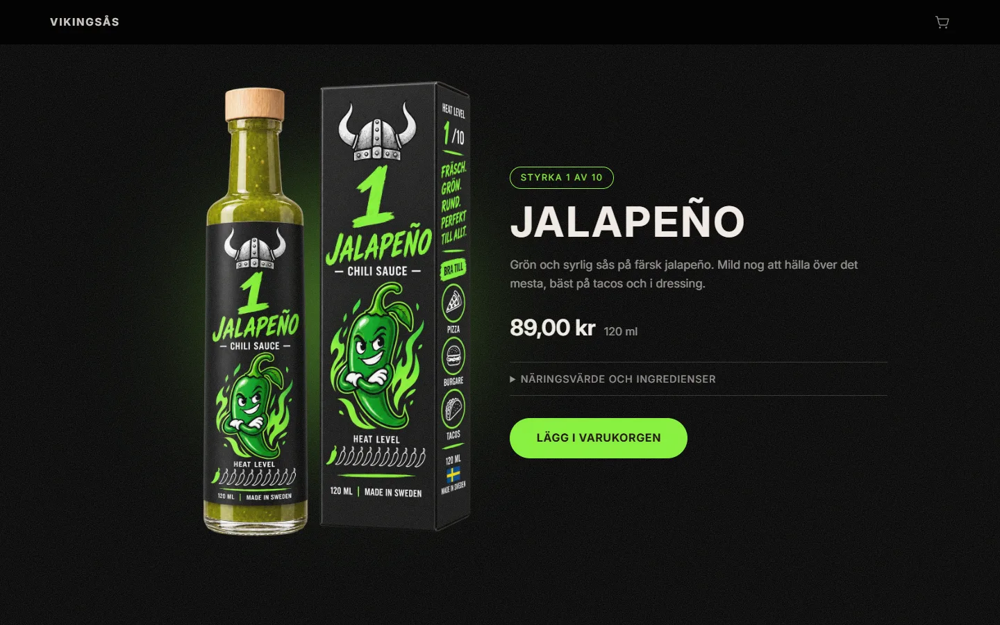
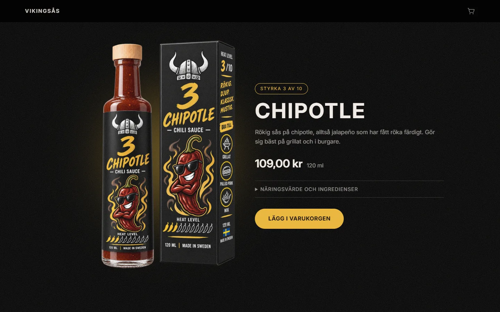
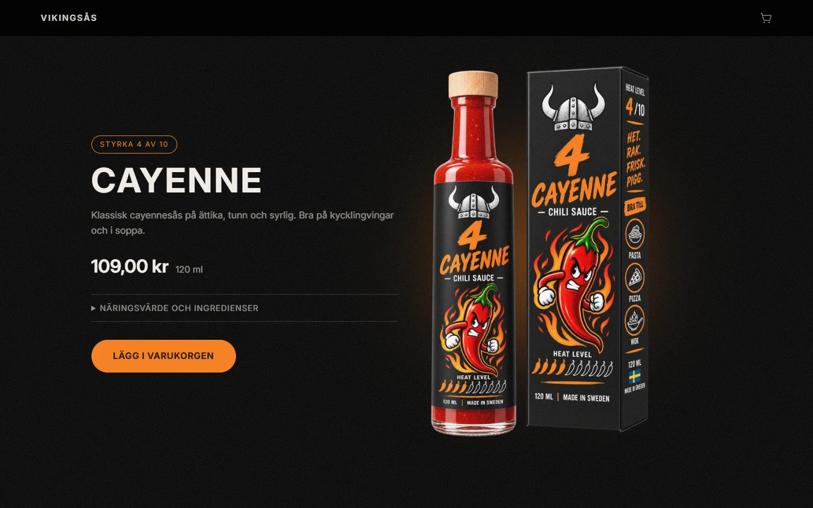
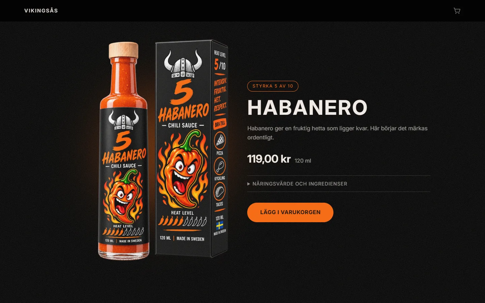
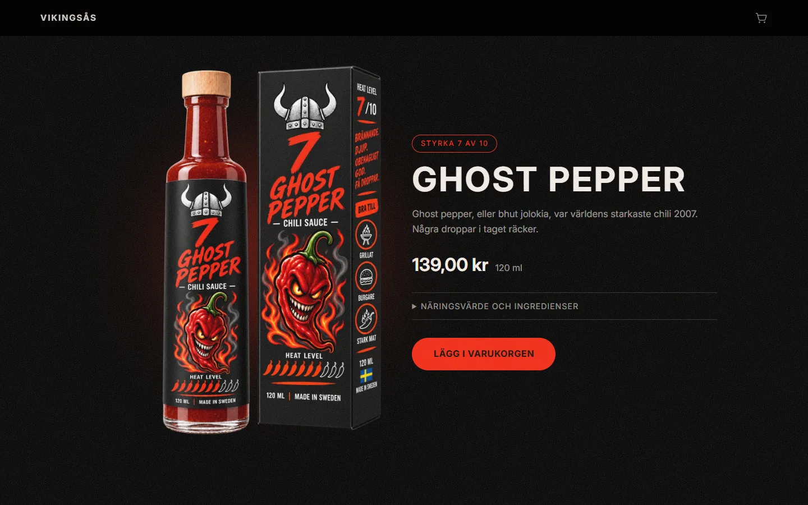
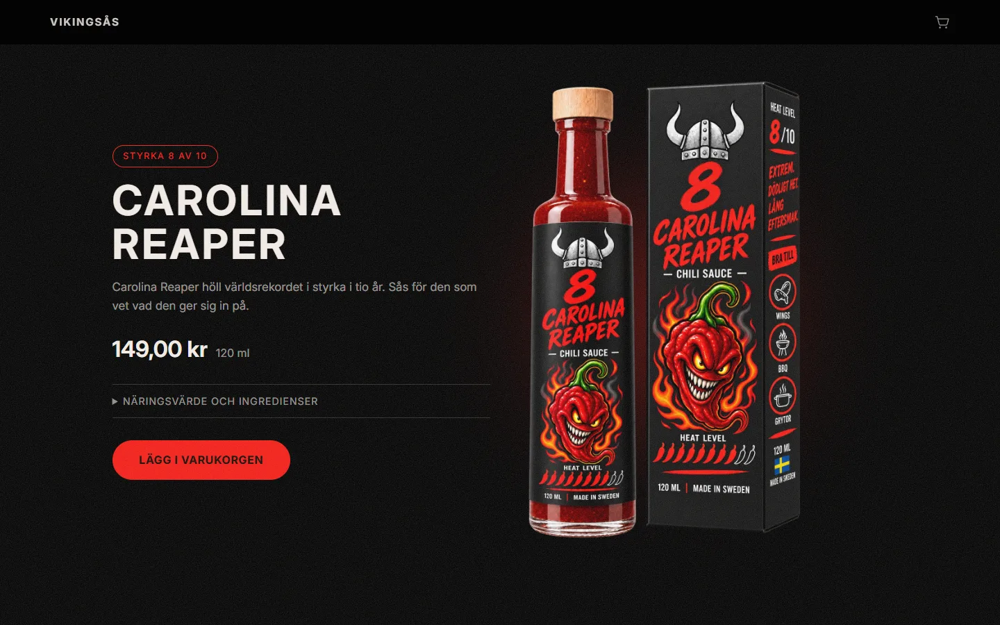
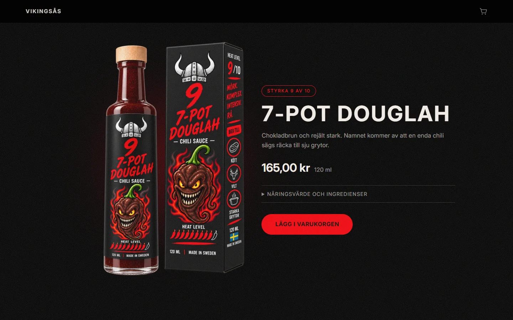
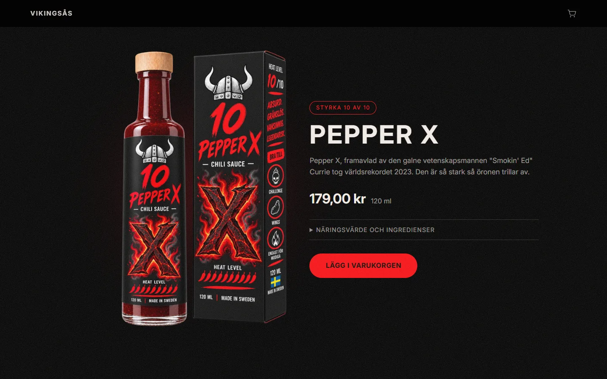

# Vikingsås

E-handel med tio chilisåser i stigande styrka, från en mild jalapeño till Pepper X. Byggd som skoluppgift i kursen Systemutveckling på Medieinstitutet.

Vidareutvecklad i kursen Integration med 3-partssystem.

Sajten ligger på https://chili-ehandel.vercel.app


## Om uppgiften

Uppgiften hette "Min egna e-handel" och gick ut på att bygga en butik som fungerar för både kunder och administratörer. Admin lägger till och redigerar produkter som sparas i databasen. Kunden ser produkterna, lägger dem i en varukorg, "betalar" och skapar en order som admin sedan kan se. Betalningen är bara ett formulär med namn och e-post, ingen riktig betallösning. Sidan skulle också vara deployad så att andra kan se den.

Innan bygget skulle tidsplan, sitemap och ER-diagram tas fram. De ligger i [docs/](docs/).

För VG skulle dessutom:

- varukorgen sparas i databasen istället för bara i React
- det finnas inloggning så att bara administratörer kan redigera produkter
- admin kunna sätta orderstatus: Beställd, Behandlas, Levererad, Återbetald

Alla krav för både G och VG är uppfyllda.

## Produkterna

Varje sås har en egen sektion på startsidan med styrka, pris och en utfällbar ruta för näringsvärde och ingredienser. Glöden bakom flaskan och knappen har samma färg som etiketten.

<p>
  
  
  
  
  
  
  
  
  
  
</p>

## Funktioner

### Kund

- mina tio egna såser på startsidan
- alla produkter med sökning och bläddring på `/produkter`
- priser i SEK, EUR, NOK eller DKK
- varukorg som sparas i databasen och kopplas till besökaren med en cookie, kunder behöver inte logga in
- kassa med namn, e-post, telefon och adress, och kortbetalning med Stripe
- frakt med PostNord: ombud, paketbox eller hemleverans, beräknad leverans och fri frakt över en gräns
- tacksida som visar ordern, frakten och om betalningen har gått igenom
- inloggning med Google, och Mina sidor med kundens egna beställningar
- orderbekräftelse via e-post när betalningen är klar

### Admin

- inloggning med express-session, sessionerna sparas i Postgres och lösenorden hashas med bcrypt
- skapa och redigera produkter, och slå av eller på dem med en switch
- importera leverantörens produkter som CSV eller XML
- lista med alla ordrar och en detaljsida per order, med betalstatus och frakt
- ändra orderstatus
- välja ombud i efterhand för ordrar där PostNord inte svarade
- ändra fraktpriser och gränser för fri frakt

Adminpanelen länkas inte från butiken, den nås på `/admin/logga-in`.

## Tekniker

- React, Vite och React Router
- Express 5 och TypeScript
- PostgreSQL hos Supabase, egen SQL via `pg`
- express-session med connect-pg-simple, bcryptjs
- Zod för att validera data från andra system och från webbläsaren
- Algolia för sökningen, Stripe för betalningen, Frankfurter för valutakurserna, PostNord för frakten
- Google (OAuth 2.0 och OpenID Connect) för kundinloggningen, Resend för e-posten
- Nodes inbyggda testkörare via tsx
- Vercel

## Vad jag övade på

- rita ett ER-diagram och bygga tabellerna efter det
- spara produktnamn och pris på orderraden, så att en gammal order inte ändras när admin ändrar priset
- transaktioner, en order och dess rader sparas allt eller inget
- `json_agg` för att hämta en order med alla rader i en och samma fråga
- sessionsbaserad inloggning och middleware som skyddar admin-routes
- React Context för antalet i varukorgen
- deploy med Vercel CLI

## Integrationer

I kursen Integration med 3e partssystem byggde jag vidare på samma butik och kopplade ihop den med externa tjänster. Alla anrop går via Express, varje tjänst har en egen adapter i `server/integrations/` och nycklarna ligger i `.env`.

### Import från leverantören

Admin kan hämta leverantörens produktkatalog som CSV eller XML, med en knapp per format på produktsidan i admin. Varje rad valideras med Zod innan den sparas, och efteråt visas en rapport med nya, uppdaterade och överhoppade produkter. Importen gör upsert på artikelnumret, så en andra import skapar inga dubbletter.

Så här gjorde jag med fälten:

- **Artikelnummer** sparas i en ny kolumn i databasen, `sku` som är unik. Det är den importen använder för att avgöra om produkten redan finns, och den blir `objectID` i Algolia. Mina egna tio såser fick VS-001 till VS-010.
- **EAN** sparas som text, inte tal annars försvinner nollan i början.
- **Kategori** sparas i `category` i products så att den kan användas som filter i sökningen. Den borde nog läggas som egen tabell så att samma kategori inte kan stavas på flera sätt (single source of truth).
- **Pris** har decimalkomma i CSV-filen och decimalpunkt i XML-filen, båda blir samma tal. En produkt utan pris hoppas över (LEV-1037 har "ej satt") och orsaken står i rapporten.
- **Lagersaldo** som saknas blir `null`, alltså okänt. 0 betyder att varan är slut, och det vet jag inte.
- **Varianter** sparas som en lista (`TEXT[]`). Där står storleken, till exempel 150 ml och 250 ml.
- **Uppdaterad** tar jag inte med, butiken har ingen användning för datumet.
- **Volym och styrka** finns inte hos leverantören. Jag gjorde kolumnerna frivilliga hellre än att gissa ett värde. Men det är en svaghet. Jag får anställa ett team som bedömer styrkan i varje produkt innan de listas i butiken.

En ny import skriver bara över leverantörens fält. Det admin har fyllt i själv, som beskrivning, bild och styrka, ligger kvar.

### Sökning med Algolia

Designen på e-handeln var från början tänkt att bara rymma tio produkter (Vikingsås är ett litet lokalt bolag). För att få plats med fler produkter gjorde jag om förstasidan till en slags "spotlight" och skapade en separat produktsida, `/produkter`, med ett rutnät som rymmer alla nya produkter utan att användaren behöver scrolla flera kilometer. Då föll det sig naturligt att ha sökrutan där. Startsidan hämtar från databasen och inte från Algolia, så butiken fungerar även om sökningen ligger nere.

- React anropar bara mitt eget `GET /api/search`. Express frågar Algolia via `server/integrations/searchAdapter.ts` och svarar i butikens format, `{ products, meta: { page, pageSize, total, totalPages } }`, inte med Algolias råa svar.
- Ingen Algolia-nyckel finns i webbläsaren. Skrivnyckeln och söknyckeln ligger båda på servern.
- Artikelnumret (`sku`) är `objectID`, så en ändrad produkt uppdateras i stället för att dyka upp två gånger.
- Databasen först, sedan Algolia. När admin skapar, ändrar eller stänger av en produkt, eller kör en import, sparas den först i databasen. Svarar inte Algolia är produkten ändå sparad, och admin får en varning om att sökindexet inte är uppdaterat. En avstängd produkt tas bort ur sökningen.
- Parametrarna valideras med Zod. Sidorna räknas från 1 hos mig och från 0 hos Algolia. 12 produkter per sida som standard, max 50. `?page=0` och `?pageSize=1000` ger 400 med ett begripligt fel.
- Söktext och sida står i adressen (`/produkter?q=habanero&page=2`), så bakåtknappen, omladdning och länkar fungerar.
- Sökningen körs medan man skriver, rent krasst för användarupplevelsen. Den väntar tills man har pausat i 300 ms (debounce), annars blir det ett anrop per tangent och Algolias gratisnivå har ett tak.

### Betalning med Stripe

Kunden betalar med Stripe Checkout i testläge. Jag valde embedded, där Stripes formulär ligger inne i kassan, i stället för hosted där kunden skickas till Stripes egen sida. Jag tänkte att det skulle ge mer förtroende när kunden stannar i butiken hela vägen. Nu när jag sett hur formuläret beter sig är jag mer osäker. Det går bara att styla med färger, typsnitt och hörn (`branding_settings`), så det ser ut som Stripe och inte som Vikingsås. Vill jag ha full kontroll är nästa steg Stripe Elements, där jag bygger formuläret själv av Stripes fält.

Så går ett köp till:

1. Kunden fyller i namn, e-post, telefon och adress. React skickar bara de uppgifterna till `POST /api/orders`, inga produkter och inga priser. Varukorgen finns redan i databasen.
2. Servern läser varukorgen och priserna ur databasen och kontrollerar lagersaldot. Ordern och raderna sparas som Obetald i en transaktion.
3. Först därefter skapar servern en Checkout Session hos Stripe, med orderns id som `client_reference_id`. Kassan får tillbaka en `clientSecret` och visar Stripes formulär.
4. Kunden betalar och skickas till `/tack?session_id=...`.
5. Stripe skickar en webhook till `POST /api/stripe/webhook`. Servern verifierar signaturen och sätter ordern som Betald, minskar lagersaldot och tömmer varukorgen, allt i en transaktion.

Tacksidan visar bara status. Den hämtar ordern med sessionens id och frågar igen varannan sekund så länge ordern är Obetald, eftersom kunden och webhooken kommer tillbaka ungefär samtidigt. Varken tacksidan eller något annat i React kan sätta ordern som betald, det gör bara webhooken. Sessionens id används i stället för orderns, eftersom order-id går att gissa (1, 2, 3).

Val jag har gjort:

- Betalningen har en egen kolumn, `payment_status` (Obetald, Betald, Avbruten). Den gamla `status` handlar om leveransen och fick vara kvar.
- Webhooken ligger före `express.json()` i `app.ts` och läser bodyn med `express.raw`. Signaturen räknas på exakt de bytes Stripe skickade, och görs de om till JSON först stämmer den inte. Fel signatur ger 400 och ingen order ändras.
- Samma händelse kan komma flera gånger. Ordern blir bara Betald om den är Obetald (`WHERE payment_status = 'Obetald'`), så andra gången ändras inga rader och lagret minskas inte igen.
- Varukorgen töms först när betalningen är klar. Avbryter kunden finns varorna kvar.
- Tomt lagersaldo räknas som slut i lager. Det är ett medvetet val. Tomt betyder att vi inte vet, och då finns det inget saldo att dra vid köp. En kund skulle kunna beställa 1000 chilisåser som vi inte har i lager.
- Sessionen löper ut efter 30 minuter (`expires_at`), annars väntar Stripe i 24 timmar. Då skickar Stripe `checkout.session.expired` och ordern blir Avbruten. En betald order ändras aldrig.
- Stripe räknar i öre, `Math.round(pris * 100)`. Utan `Math.round` kan 49,90 bli 4989,999... i JavaScript.
- Stripes egen timeout är 80 sekunder, alldeles för länge för en kund som väntar. Min väntar max 10 sekunder, sedan får kunden ett begripligt fel och ordern förblir Obetald.
- Kassan tar fullständig adress i egna kolumner (`shipping_street`, `shipping_postal_code`, `shipping_city`). Det kommer hjälpa senare när frakten ska in, transportbolagets API vill ha varje del för sig.
- Egen validering med en röd rad under fältet i stället för webbläsarens varningar. Servern kollar samma sak med Zod, eftersom det går att runda webbläsaren.
- Den hemliga nyckeln finns bara på servern. React får bara den publika, `VITE_STRIPE_PUBLISHABLE_KEY`. Den byggs in i JavaScript-filen som alla besökare laddar ner, så på Vercel ligger den som Config och inte som Secret.

### Frakt med PostNord

I kassan väljer kunden ombud eller paketbox, eller hemleverans. När postnumret är ifyllt visas fraktalternativen med pris och beräknad leverans. Väljer kunden ombud visas de fem närmaste ombuden och de fem närmaste paketboxarna, och för det valda ombudet öppettider och en länk till kartan. Labben gjordes med AI, se nästa avsnitt.

Så går det till:

1. Kassan frågar `GET /api/shipping/options?postalCode=...` först när postnumret är fem siffror, inte vid varje tangenttryckning. Samma postnummer frågas bara en gång.
2. Servern hämtar fraktpriserna ur databasen, räknar priset på varukorgen i databasen och frågar PostNord om ombud och leveranstid. Kassan får butikens format, aldrig PostNords svar.
3. Väljer kunden ett ombud hämtas leveranstiden till just det ombudet.
4. Vid beställningen skickar React bara fraktsättet och ombudets id, aldrig ett pris. Servern kontrollerar att ombudet finns för postnumret, räknar priset igen och sparar fraktsätt, pris och ombud på ordern.
5. Frakten blir en egen rad i Stripe. Ordern och Stripe får samma rader, så `total_amount` är alltid samma belopp som kunden betalar.

Val jag har gjort:

- **En adapter som går att byta.** `server/integrations/shippingCarrier.ts` beskriver vad ett transportbolag ska kunna: hitta ombud och räkna fram leveranstid. `postnordAdapter.ts` är den enda filen som vet hur PostNord fungerar. Vill jag byta bolag skriver jag en ny adapter och ändrar en rad.
- **Fraktpriserna ligger i databasen**, i tabellen `shipping_methods`, så att de kan ändras i admin under Frakt utan ny deploy. Ordern sparar en kopia av namnet och priset, samma princip som orderraderna, så en gammal order visar det kunden faktiskt betalade.
- **Priser och gränser för fri frakt.** Ombud kostar 69 kr med fri frakt från 399 kr, hemleverans 139 kr med fri frakt från 499 kr. Jag simulerade varukorgar utifrån butikens priser och jämförde med PostNords prislista. Vid 399 kr ligger fler kunder precis under gränsen än över den, så en sås till ger fri frakt. 69 kr är mindre än en typisk sås men mer än de billigaste produkterna, så nära gränsen är det billigare att lägga till chiliflakes än att betala frakten. Hemleverans kostar PostNord mer, därför ligger både pris och gräns högre.
- **Paketboxar finns med**, i en egen grupp. PostNord rekommenderar att ombud och paketboxar hämtas var för sig.
- **Bara inom Sverige.** Valutaväljaren räknar om priserna, men kunden betalar i kronor, och kassan och varukorgen säger att vi bara skickar inom Sverige.
- **Kunden kan handla även om PostNord inte svarar.** Ordern får ombudsstatus Väntar, och kassan säger att vi väljer ett ombud nära kundens adress. I admin markeras betalda ordrar som saknar ombud, och där kan jag hämta ombud från PostNord och spara ett i efterhand. Villkoren står i samma `UPDATE` som sparar valet, så två administratörer kan inte skriva över varandra.
- **Ett tekniskt fel är inte samma sak som ett nej.** Säger PostNord att det inte finns några ombud går ombud inte att välja, kunden får hemleverans. Säger PostNord att postnumret inte finns visas ett fel under postnummerfältet. Avvisar PostNord anropet loggas det som ett integrationsfel, inte som att PostNord ligger nere.
- **Leveranstiden är en uppskattning.** Den räknas från när paketet lämnas till PostNord, inte från när kunden beställer: före kl. 12 på vardagar samma dag kl. 14, annars nästa vardag. Det är mina egna antaganden, och helgdagar hanteras inte än. Går leveranstiden inte att hämta står det "Beräknad leveranstid är tillfälligt otillgänglig.", och det stoppar aldrig ett köp.
- **Tacksidan visar bara ordern för den som lade den.** Utöver Stripes sessions-id måste ordern höra till varukorgen i besökarens kaka, eftersom id:t står i adressen och kan hamna i historiken.
- **Nyckeln skickas i adressen**, eftersom PostNords dokumentation säger så. Därför skrivs adressen aldrig i något felmeddelande, och nyckeln maskeras i allt som loggas.

### Så använde jag AI i labb 5

AI skrev koden för frakten, och jag kontrollerade den mot PostNords dokumentation och sandlåda. Verktyget var Claude Code i VS Code, och ChatGPT fick granska planen och koden. `.env` var blockerad för Claude, jag godkände varje kommando, och nyckeln klistrades aldrig in i en chatt. Alla prompter och svar finns i [docs/ai-logg-labb5.md](docs/ai-logg-labb5.md), och skillnaderna mot PostNords dokumentation i [docs/postnord-avvikelser.md](docs/postnord-avvikelser.md).

- **Prompter:** sammanfatta labben och gör en plan, lägg priserna i databasen, räkna fram gränserna för fri frakt, hantera att PostNord inte svarar, ta med paketboxar, och ChatGPT:s krav på felhantering och tester.
- **Vad AI:n föreslog:** en endpoint för leveranstid som gav 502, ett svar som antogs vara ett objekt, och `startTime` som tiden då kunden beställer.
- **Vad som skilde sig:** rätt endpoints är `/transittime/addresstoaddress` och `/transittime/addresstolocation`, svaret är en lista där fel kommer som rader i ett 200 OK, och `startTime` är när PostNord får paketet. Dokumentationen hade också egna fel, till exempel en lista med ombudstyper som ger 400 för Sverige, och latitud och longitud som har bytt plats.
- **Hur det löstes:** varje antagande prövades mot sandlådan innan koden skrevs om, och testerna skrevs innan de sista bristerna rättades. Första körningen gav 9 fel av 56, och alla rättades.

### Orderbekräftelse med Resend

När en order blir betald får kunden en orderbekräftelse till e-postadressen från kassan. Mejlet har ordernumret i ämnesraden, kundens namn, produkterna med antal och pris, frakten och totalsumman, både som HTML och som vanlig text.

- **En fil känner till Resend.** `server/integrations/emailAdapter.ts` har adressen och nyckeln, väntar max 5 sekunder och kontrollerar Resends svar med Zod. Innehållet byggs i `server/lib/orderConfirmation.ts`, Resend vet ingenting om ordrar.
- **Skickas i webhooken, inte vid köpet.** Mejlet går iväg först när Stripes webhook har satt ordern som Betald och transaktionen är klar. Kunden som klickar på Köp men aldrig betalar får inget mejl.
- **En bekräftelse per order, på två sätt.** Webhooken skickar bara när ordern just gick från Obetald till Betald, så en händelse som kommer igen från Stripe skickar inget. Varje utskick har dessutom en `Idempotency-Key`, `order-confirmation/<orderns id>`, så Resend skickar inte samma mejl två gånger inom 24 timmar även om koden skulle försöka.
- **Ett misslyckat mejl stoppar inte ordern.** Ordern är redan betald när mejlet skickas. Svarar Resend inte, eller med ett fel, loggas det och webhooken svarar ändå 200. Ett 500 hade fått Stripe att skicka händelsen igen för en order som redan är klar. Svagheten är att mejlet inte försöks igen av sig själv, men felet och ordernumret står i loggen.
- **Kundens uppgifter escapas.** Namn och produktnamn kommer utifrån, och utan escaping kan ett namn som `<a href="...">` bli en riktig länk i mejlet. `&` byts först, annars blir det som redan escapats fel.
- **Avsändaren är `onboarding@resend.dev`**, eftersom jag inte har verifierat någon domän. Den kan bara skicka till adressen på mitt Resend-konto. En beställning med en annan adress blir betald som vanligt, och Resends 403 hamnar i loggen.

## Autentisering

Kunder loggar in med sitt Google-konto via OAuth 2.0 och OpenID Connect. Det är frivilligt, det går fortfarande att handla som gäst. Den som är inloggad får sina beställningar under Mina sidor, och namn och e-post ifyllda i kassan. Admin loggar in med e-post och lösenord som tidigare.

### Inloggningsflödet

1. Kunden klickar på Logga in med Google på `/mina-sidor`. Länken går till min server, `GET /api/auth/google`, inte direkt till Google.
2. Servern skapar två slumpade värden, `state` och en code verifier, och sparar dem i två httpOnly-kakor som gäller i 10 minuter och bara skickas till `/api/auth/google`. Sedan skickas kunden till Google med `state`, hashen av verifiern (`code_challenge`), mitt client id, callback-adressen och scope `openid email profile`. Google frågar alltså bara om namn och e-post.
3. Kunden loggar in hos Google och skickas tillbaka till `GET /api/auth/google/callback?code=...&state=...`.
4. Servern jämför `state` med kakan och raderar båda kakorna, de används bara en gång. Saknas kakan eller skiljer sig värdet avbryts inloggningen.
5. Servern byter koden mot tokens hos Google, direkt mellan servern och Google, med client secret och code verifier. Client secret finns bara i `.env` och på Vercel.
6. Servern läser kunden ur ID-token och kontrollerar med Zod att den är utfärdad av Google (`iss`), till min app (`aud`), inte har gått ut (`exp`) och att e-postadressen är verifierad.
7. Kunden letas upp på Googles `sub` i tabellen `customers`, eller skapas om den inte finns. Namn och e-post uppdateras vid varje inloggning.
8. Servern startar en ny session med kundens id och skickar kunden till Mina sidor. Nu vet shoppen vem kunden är.

Trycker kunden på Avbryt hos Google, eller svarar Google inte inom 5 sekunder, hamnar kunden på Mina sidor med ett begripligt fel i stället för en trasig sida.

**state och PKCE skyddar mot olika saker, och jag valde båda.**

- `state` skyddar mot att någon annan startar inloggningen. Utan den kan en angripare logga in på sitt eget konto, stoppa innan callbacken och skicka sin callback-länk till kunden. Kunden blir då inloggad som angriparen, och det kunden sedan köper hamnar på angriparens konto. Med `state` avvisas länken, eftersom kunden inte har en kaka med samma värde.
- PKCE skyddar koden. Snappar någon upp koden på vägen tillbaka, till exempel i en logg eller i webbläsarens historik, går den inte att byta mot tokens utan verifiern. Google fick bara hashen i början och kontrollerar att verifiern ger samma hash.

Min server har client secret, så koden går inte att byta utan den ändå. PKCE är alltså ett extra lager här, men det kostade bara några rader.

### Tokens

- **ID-token från Google.** En JWT med vem kunden är: `sub`, e-post, namn. Den gäller i en timme, men jag använder den bara en gång, i callbacken, och sparar den inte. Signaturen kontrolleras inte, eftersom token kommer direkt från Google över https och aldrig passerar webbläsaren. Fälten kontrolleras däremot.
- **Access token från Google.** Kommer i samma svar och gäller i en timme. Den används för att anropa Googles API:er för kundens räkning, och det behöver butiken inte. Den används inte och sparas inte. Ingen refresh token, eftersom jag inte ber om åtkomst när kunden inte är inne.
- **Butikens sessionskaka, `vikingsas_session`.** Det enda som stannar i webbläsaren. Den innehåller bara ett slumpat, signerat id. Själva sessionen med kundens id ligger i tabellen `session` i Postgres. Kakan är httpOnly, så JavaScript kan inte läsa den, Secure i produktion, så den bara skickas över https, och SameSite=Lax. Den gäller i 24 timmar eller tills kunden loggar ut.
- **Kakorna `oauth_state` och `oauth_verifier`.** Gäller i 10 minuter och raderas i callbacken.
- **Resends API-nyckel.** Butikens egen nyckel, ingen kund är inblandad. Den ligger i `.env` och på Vercel och gäller tills jag spärrar den i Resend.

Inga tokens från Google och inga nycklar når webbläsarens JavaScript. React frågar `GET /api/auth/me` vem som är inloggad och får bara namn och e-post.

### Session eller JWT

Jag valde session, samma som admin redan hade, i stället för en JWT i kakan.

- **Den går att spärra direkt.** Sessionen ligger i databasen. När kunden loggar ut raderas den, och kakan slutar fungera samma sekund. Blir en kaka stulen kan sessionen raderas. En JWT gäller tills den går ut, och för att stoppa den tidigare behövs en spärrlista i databasen, och då har jag byggt en session ändå.
- **Kakan avslöjar ingenting.** En JWT bär kundens uppgifter i klartext, bara signerade. Sessionskakan är ett slumpat id.
- **Den fanns redan.** express-session med sessionerna i Postgres användes för admin, så det blev inga nya paket och ingen ny hemlighet.

Nackdelen är att varje skyddat anrop slår upp sessionen i databasen. För en butik med en server och en databas spelar det ingen roll. JWT passar bättre när flera tjänster ska kunna kontrollera inloggningen utan att dela databas.

Två saker till:

- **Nytt sessions-id vid varje in- och utloggning** (`req.session.regenerate`). Ett id som någon har fått tag på innan inloggningen blir då oanvändbart.
- **Admin och kund i samma webbläsare.** Båda ligger i samma session, och den ena loggar inte ut den andra.

### Konton och e-postadresser

Kunder känns igen på Googles `sub`, aldrig på e-postadressen. Byter kunden e-post hos Google är det fortfarande samma kund.

Lösenordsinloggningen finns bara för admin, i tabellen `users`. Kunderna ligger i en egen tabell, `customers`, och ingenting slås ihop. En admin som loggar in med Google blir en vanlig kund utan adminrättigheter, även om e-postadressen är densamma. Gästordrar med samma e-postadress kopplas inte heller till kontot i efterhand, eftersom vem som helst kan skriva vilken adress som helst i kassan.

Mina sidor hämtar `GET /api/account/orders`, som svarar 401 utan inloggning. Kundens id tas från sessionen, aldrig från webbläsaren, så en kund kan bara se sina egna ordrar. Avbrutna köp visas inte.

## Reflektion

### Integrationsmodeller

- **Leverantören: fil.** Katalogen hämtas som CSV eller XML och läses in i ett svep. Den är en hel lista som ändras sällan och importeras när admin vill, inget som behöver frågas om vid varje sidvisning.
- **Algolia: REST via SDK.** `algoliasearch` gör REST-anropen åt mig på servern. En sökning är en fråga och ett svar, och SDK:t sköter adresser och format.
- **Stripe: SDK och webhook.** Servern skapar betalningen med Stripes SDK, och kassan visar Stripes formulär inbäddat med Stripe.js i stället för en redirect. Webhooken säger när betalningen är klar. Det passar, eftersom betalningen blir klar hos Stripe i sin egen takt och inte medan kunden väntar på mitt API.
- **Supabase Storage: SDK.** `supabase-js` på servern laddar upp och tar bort bilderna, som sedan visas direkt från bucketens publika adress.
- **PostNord: REST.** Ombud och leveranstid hämtas med GET-anrop. Det finns inget SDK, och anropen är enkla frågor med ett postnummer.
- **Frankfurter: REST.** Ett GET-anrop ger dagens kurser, som cachas i 300 sekunder.

### Varför via Express

Nycklarna kan bara hållas hemliga på servern. Allt som skickas till webbläsaren går att läsa, så Stripes, Supabases och PostNords nycklar och Algolias skrivnyckel hade legat öppna. Servern kontrollerar också det kunden skickar. Pris och frakt räknas utifrån databasen och valt ombud kontrolleras mot PostNord, så ett ändrat pris i webbläsaren påverkar ingenting. Adaptrarna gör dessutom om svaren till butikens eget format, så React behöver inte ändras om en tjänst byts ut.

### Integrera eller bygga själv

- **Import:** utan filerna hade jag fått skriva in 44 produkter för hand och hålla pris och lager uppdaterade själv.
- **Sökning:** `ILIKE` hittar inget på "habanro", Algolia ger Habanero först. Att bygga det själv hade krävt en synonymordlista som måste underhållas.
- **Betalning:** PCI DSS, avtal med en inlösande bank och 3D Secure. Det jag ger bort är avgiften, 1,5 % plus 1,80 kr per köp med vanliga EES-kort.
- **Bilder:** Vercels funktioner kan inte spara filer permanent, så jag hade behövt en egen filserver med backup.
- **Frakt:** PostNord ändrar sina ombud hela tiden och rekommenderar själva att listan uppdateras varje dag. Leveranstiderna bygger på deras egna rutter, det går inte att räkna fram själv.
- **Valuta:** egna kurser hade krävt att hämta och uppdatera ECB:s data varje dag.

### När en tjänst är nere

Varje anrop har en timeout, så inget hänger kvar.

- **Frankfurter:** valutaväljaren göms och allt visas i SEK.
- **Leverantören:** importen ger ett felmeddelande och produkterna lämnas orörda.
- **Algolia:** sökningen visar ett fel, men startsidan hämtar från databasen och fungerar. Admin sparar ändå och får en varning om att sökindexet inte är uppdaterat.
- **Stripe:** kunden får ett begripligt fel, ordern blir Avbruten och varukorgen ligger kvar. Svarar mitt API fel på webhooken skickar Stripe den igen.
- **Supabase Storage:** admin får ett fel och produkten behåller sin gamla bild, eftersom databasen ändras först när den nya bilden är uppladdad.
- **PostNord:** kunden kan ändå handla. Ombudet väljs i efterhand i admin, och leveranstiden visas som tillfälligt otillgänglig. Det hände på riktigt i produktion när ett tecken saknades i nyckeln.

### Risker med Stripe

Stripe kan höja avgifterna, ändra villkoren eller stänga kontot, och då står butiken utan betalning tills en ny leverantör är inkopplad. Adaptern gör bytet mindre, men kassan och webhooken är byggda för Stripe. Stripe hanterar kundens namn, e-post och kort, så ett personuppgiftsbiträdesavtal krävs. Det ingår i användaravtalet, och svenska konton har avtalet med Stripes irländska bolag. Uppgifterna kan ändå föras till USA under EU:s och USA:s Data Privacy Framework. Det kan rivas upp, som Privacy Shield 2020, och därför har Stripe standardavtalsklausuler som reserv. Att Stripe är amerikanskt kan också sticka i ögonen på kunder som vill hålla sina uppgifter inom EU.

## Kom igång

Den deployade butiken ligger på https://chili-ehandel.vercel.app

### Konton

Alla är gratis, och bara testlägen används:

- **Supabase** för databasen (Postgres) och produktbilderna. Skapa en publik bucket i Storage, till exempel `product-images`, och skriv namnet i `SUPABASE_BUCKET`. Den hemliga nyckeln hamnar i `SUPABASE_SECRET_KEY`
- **Algolia** för sökningen
- **Stripe** i testläge, och [Stripe CLI](https://docs.stripe.com/stripe-cli) för att ta emot webhooks lokalt
- **PostNord** för ombud och leveranstid. Skapa ett konto på [atdeveloper.postnord.com](https://atdeveloper.postnord.com), välj Customer plan och skapa en nyckel för sandlådan
- **Google Cloud** för kundinloggningen. Skapa ett projekt, fyll i OAuth consent screen med Audience External, och skapa en klient av typen Web application under Clients. Lägg till `http://localhost:5173/api/auth/google/callback` under Authorized redirect URIs. Client secret visas bara när klienten skapas. Med bara `openid email profile` kan alla Google-konton logga in, inga testanvändare behövs
- **Resend** för orderbekräftelserna. Skapa en nyckel under API Keys med behörigheten Sending access

Leverantörens API och Frankfurter behöver inga egna konton.

### Starta lokalt

Installera beroenden:

```
npm install
```

Kopiera `.env.example` till `.env` och fyll i värdena. Där står varje variabel och var den hittas.

Kör `db/schema.sql` och sedan `db/seed.sql` i Supabase SQL editor. Finns databasen redan körs i stället de filer i `db/migrations/` som inte är körda, se Databas. Skapa ett adminkonto:

```
npx tsx --env-file=.env create-admin.ts <e-post> <lösenord>
```

Starta sedan två terminaler, en för frontend och en för API:et:

```
npm run dev
npm run dev:api
```

Frontend hamnar på http://localhost:5173 och API:et på http://localhost:3000. Vite skickar vidare allt som börjar med `/api` till Express, så webbläsaren ser bara en adress och jag slipper CORS. Hamnar Vite på en annan port måste `CLIENT_URL` i `.env` ändras till samma, annars skickas kunden till fel adress efter betalningen.

### Testa integrationerna lokalt

**Import.** Logga in i admin och klicka på CSV eller XML på produktsidan.

**Sökning.** Första gången behöver alla produkter skickas till Algolia. Logga in i admin, öppna webbläsarens konsol och kör:

```
fetch('/api/admin/search/index', { method: 'POST' })
```

Efter det håller admin och importen sökindexet uppdaterat.

**Betalning.** Stripe kan inte nå localhost, så webhooken tas emot med Stripe CLI i en tredje terminal:

```
stripe login
stripe listen --events checkout.session.completed,checkout.session.async_payment_succeeded,checkout.session.expired --forward-to localhost:3000/api/stripe/webhook
```

`stripe listen` skriver ut en `whsec_...`. Lägg den i `.env` som `STRIPE_WEBHOOK_SECRET` och starta om `npm run dev:api`.

Betala med testkortet `4242 4242 4242 4242`, ett framtida datum och valfri CVC. För att testa en utgången session utan att vänta 30 minuter:

```
stripe checkout sessions expire <cs_test_...>
```

Sessionens id står i kolumnen `stripe_session_id` i `orders`.

**Bilder.** Logga in i admin, öppna en produkt och välj en bild, JPEG, PNG eller WebP på högst 4 MB. Bilden visas i butiken från Supabase Storage. En PDF eller en större fil ger ett fel under fältet.

**Frakt.** Lägg något i varukorgen, gå till kassan och skriv ett postnummer, till exempel 393 65. Sandlådan ger ombud och leveranstider med PostNords testdata. 00000 ger felet för ett postnummer som inte finns. Fraktpriserna ändras i admin under Frakt.

**Inloggning.** Öppna http://localhost:5173/mina-sidor och logga in med Google. Vite måste ligga på samma port som i `GOOGLE_CALLBACK_URL`, annars stoppar Google inloggningen. Tryck på Avbryt hos Google för att se felmeddelandet.

**E-post.** Köp något med e-postadressen till ditt Resend-konto. Mejlet syns i inkorgen och under Emails i Resend. Med en felaktig `RESEND_API_KEY` blir ordern ändå betald, och felet står i terminalen där API:et kör.

**Tester.** `npm test` kör testerna för frakten, inloggningen och e-posten. De använder låtsade svar, så de behöver ingen `.env` och anropar aldrig PostNord, Google eller Resend.

## Kommandon

| Kommando            | Gör                                                     |
| ------------------- | ------------------------------------------------------- |
| `npm run dev`       | startar frontend                                        |
| `npm run dev:api`   | startar API:et, läser `.env` och startar om vid ändring |
| `npm run build`     | typkontroll med `tsc -b`, sedan bygger frontend         |
| `npm run preview`   | visar det byggda resultatet lokalt                      |
| `npm run lint`      | kör oxlint                                              |
| `npm test`          | kör testerna, utan nycklar och utan anrop utåt          |
| `npx vercel --prod` | deployar till produktion                                |

## Databas

SQL:en körs manuellt i Supabase SQL editor, det finns ingen automatisk migrering.

- `db/schema.sql` skapar tabellerna i en ny, tom databas
- `db/seed.sql` lägger in de tio produkterna och de två fraktsätten. Körs bara en gång, `title` är inte unik så en andra körning ger dubbletter
- `db/migrations/` innehåller ändringar som körs en gång mot en databas som redan finns, en fil per ändring med datum i namnet. Samma ändringar står också sist i `db/schema.sql`

Tabellen `customers` har Row Level Security på utan regler. Det stänger Supabase publika API för kundernas namn och e-post. Servern ansluter som ägare av tabellen och påverkas inte.

Supabase-projektet får inte pausas, då slutar den deployade butiken visa produkter.

## Deploy

Vercel är inte kopplat till GitHub eftersom projektet ligger på Medieinstitutets konto, CLI:n laddar upp filerna som ligger på disk. Därför gäller ordningen:

```
git commit -am "..."
git push
npx vercel --prod
```

Hoppa inte över push, annars börjar produktionen och repot skilja sig åt.

Kontrollera efteråt att API och databas svarar, https://chili-ehandel.vercel.app/api/health ska ge `"status":"ok"` och antalet produkter:

```
{"status":"ok","products":55}
```

Nycklarna ligger som miljövariabler på Vercel, samma namn som i `.env.example`. Tre skillnader mot lokalt:

- `CLIENT_URL` är `https://chili-ehandel.vercel.app`
- `VITE_STRIPE_PUBLISHABLE_KEY` måste finnas innan deployen, Vite bygger in den i frontend
- `STRIPE_WEBHOOK_SECRET` kommer från webhook-endpointen i Stripe Dashboard, inte från `stripe listen`. Endpointen pekar på `https://chili-ehandel.vercel.app/api/stripe/webhook` och lyssnar på samma tre händelser som i Kom igång.

För frakten behövs `POSTNORD_API_URL` och `POSTNORD_API_KEY`. `SHOP_POSTAL_CODE`, `SHIPPING_CUTOFF_HOUR` och `SHIPPING_HANDOVER_HOUR` kan utelämnas, då gäller 39365, 12 och 14. En ändrad variabel gäller först efter nästa deploy.

För inloggningen behövs `GOOGLE_CLIENT_ID`, `GOOGLE_CLIENT_SECRET` och `GOOGLE_CALLBACK_URL=https://chili-ehandel.vercel.app/api/auth/google/callback`. Samma adress måste stå under Authorized redirect URIs i Google Cloud. För e-posten behövs `RESEND_API_KEY` och `EMAIL_FROM`.

Express ligger bakom Vercels proxy, därför står `app.set('trust proxy', 1)` i `app.ts`. Utan den tror Express att anropet kom över http, och då skickas aldrig sessionskakan som är Secure.

Vercel kör `vite build` i molnet, inte `npm run build`. Typkontrollen sker alltså bara lokalt, körs innan deploy.

## Om något strular

**`Error: Not authorized` vid deploy.** Inloggningen är borta. Kör `npx vercel login`, välj GitHub, kontrollera sedan med `npx vercel whoami`.

**npx vill installera `vercel` igen.** Normalt, inget fel. npx cachar paketet och hämtar senaste versionen när cachen är tom.

**Produkterna syns inte på sajten.** Kolla `/api/health` först. Svarar den med ett felmeddelande ligger problemet i databasen, inte i frontend.

**`stripe` känns inte igen i VS Code-terminalen.** VS Code har kvar sökvägarna från innan Stripe CLI installerades. Starta om VS Code, eller läs in dem på nytt i PowerShell:

```
$env:Path = [Environment]::GetEnvironmentVariable('Path','Machine') + ';' + [Environment]::GetEnvironmentVariable('Path','User')
```

**`stripe listen` säger "must specify events".** Händelserna måste anges med `--events`, se Kom igång.

**Tacksidan står kvar på "Väntar på betalningen".** Webhooken kommer inte fram. Lokalt: kolla att `stripe listen` är igång och att `STRIPE_WEBHOOK_SECRET` är den den skrev ut. I produktion: öppna webhook-endpointen i Stripe Dashboard, där syns varje försök och vad servern svarade.

**Tacksidan kan inte nås efter betalningen lokalt.** Stripe skickar kunden till `CLIENT_URL`. Startade Vite på en annan port än den som står där hamnar kunden fel.

**Kassan visar inga ombud, eller säger att leveransalternativet inte kunde kontrolleras.** Sök på "Integrationsfel mot PostNord" eller "PostNord svarar inte" i loggen på Vercel. Raden visar vad PostNord svarade, och nyckeln är maskerad. Hos mig saknades ett tecken i `POSTNORD_API_KEY` på Vercel.

**Google säger `redirect_uri_mismatch`.** `GOOGLE_CALLBACK_URL` stämmer inte tecken för tecken med en adress under Authorized redirect URIs. Lokalt är det oftast att Vite har startat på en annan port.

**Ingen orderbekräftelse kommer fram.** Sök på "Orderbekräftelsen för order" i loggen. Med `onboarding@resend.dev` som avsändare ger alla andra mottagare än Resend-kontots egen adress 403.

## Dokumentation

Tidsplan, sitemap och ER-diagram ligger i [docs/](docs/). Där finns också [loggen över hur jag använde AI i labb 5](docs/ai-logg-labb5.md) och [skillnaderna mot PostNords dokumentation](docs/postnord-avvikelser.md).
